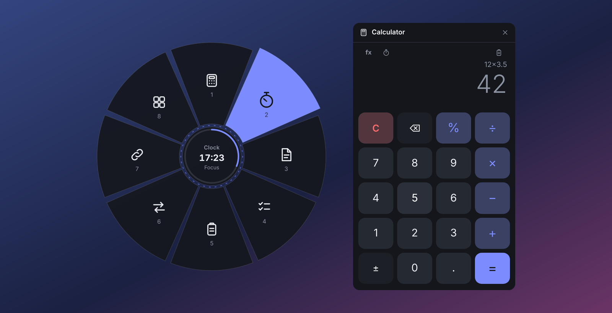
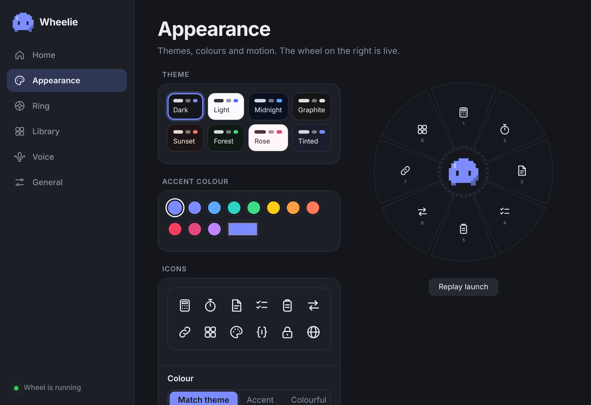
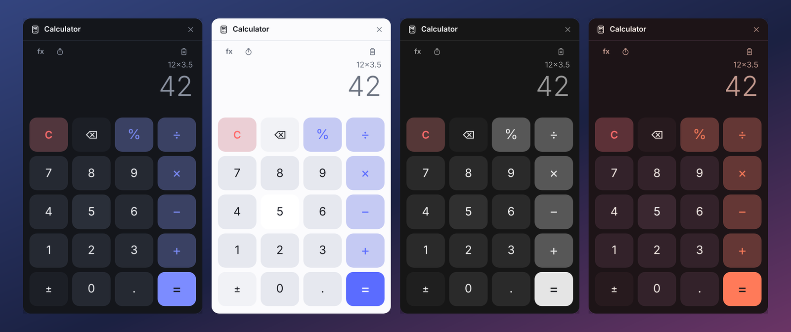
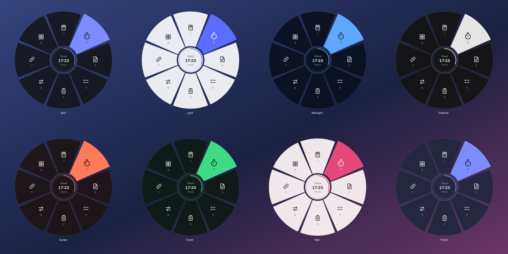

<div align="center">


# Wheelie

**A radial menu for Windows. Hold a shortcut, point at a tool, let go.**

[](https://github.com/Shazaanashraff/wheelie/actions/workflows/ci.yml)
[](https://github.com/Shazaanashraff/wheelie/releases/latest)
[](LICENSE)


[**Download**](https://github.com/Shazaanashraff/wheelie/releases/latest) ·
[Install guide](docs/installation.md) ·
[Report a bug](https://github.com/Shazaanashraff/wheelie/issues/new?template=bug_report.yml) ·
[Request a feature](https://github.com/Shazaanashraff/wheelie/issues/new?template=feature_request.yml) ·
[Contribute](CONTRIBUTING.md)



</div>

Hold **Alt + Space** (or the middle mouse button) anywhere on your PC and a ring of tools opens around your pointer. Point at one and let go: a calculator, a timer, your notes, a to-do list, your clipboard history. Or a launcher that opens an app, folder or link the instant you release. It is quick, it stays out of the way, and everything stays on your PC.

Inspired by [Helix](https://tryhelix.app/) on the Mac. Wheelie is an independent rewrite for Windows: no code, artwork or branding is shared.

## Install

> Just want the app? This is all you need.

1. Go to the **[latest release](https://github.com/Shazaanashraff/wheelie/releases/latest)**.
2. Download **`Wheelie_<version>_x64-setup.exe`** and run it. It installs just for you and needs no administrator rights.
3. Windows SmartScreen will warn that the app is unsigned. Click **More info**, then **Run anyway**.

Wheelie opens its app window the first time, and from then on lives quietly in the tray and starts with Windows. There is also a **portable** `.exe` if you would rather not install. See the **[installation guide](docs/installation.md)** for the portable version, checksums, updating, uninstalling and troubleshooting.

Requires Windows 10 or 11 (64-bit).

## Using the wheel

| Do this | To get |
| --- | --- |
| Hold **Alt + Space** (or the **middle mouse button**) | The ring opens at your pointer |
| Move to a slice and release | Opens that tool |
| Release in the centre hub | Cancels |
| A quick tap instead of a hold | The ring stays open: click a slice, or press **1** to **8** |
| **Esc**, or click away from a panel | Closes it |
| Click the tray icon | Opens the Wheelie app (right-click for Open / Quit) |

Both triggers can be changed in the app under **General**.

### The centre of the wheel

The middle of the ring is alive. When nothing is hovered, **Wheelie**, a little pixel creature, lives there. It builds itself up row by row when the ring opens, opens its eyes and looks around, then follows your pointer with them (a pixel at a time), blinks, taps its feet, hops now and then, and smiles when you hover it. Move onto a slice and the character gives way to what that tool is up to, with a **progress arc** where there is progress to show.

<p align="center"></p>

| Tool | What the centre shows |
| --- | --- |
| Clock | Time left on the running timer or pomodoro, with its progress arc; or the stopwatch |
| To-do | How many are left, with an arc of how many are done |
| Calculator | Your last result |
| Notes | How many notes you have, and the latest title |
| Clipboard | What you copied last |
| Units | Your last conversion |
| Links · Apps · Snippets | How many you have saved |
| Colours · Passwords · World clock | The current colour · password length · the time in another city |
| A launcher | Where it goes, and that it opens when you let go |

The character takes the theme's accent colour, and respects the motion setting: **Full** does everything, **Subtle** just blinks, **Off** is a still picture. It is also the app's icon.

### Two parts: the wheel and the app

- **The wheel** is the quick-touch overlay. It starts instantly and does one thing.
- **The Wheelie app** is a normal window for everything you customise: themes and colours, which tool sits in each slot (with a live ring you can click), the tool library, voice, and startup. Changes reach the wheel immediately, no restart. Closing the window just hides it; **Quit** is in the tray menu.

<p align="center"></p>

## What is in the ring

The ring has **eight slots**. Each holds a **tool** from the library or a **launcher**.

| Tool | What it does |
| --- | --- |
| **Calculator** | Its own keypad. Type or click, live result as you type, scientific keys, history. `=` copies the result. |
| **Clock** | Stopwatch, timer and pomodoro. |
| **Notes** | Every note is a plain `.txt` file in `Documents\Wheelie Notes`. Searchable history, autosave, voice dictation. |
| **To-do** | A quick checklist. |
| **Clipboard** | History of what you copied. Click to paste. Memory only; skips copies flagged by password managers. |
| **Units** | Length, weight, temperature, and more. |
| **Links** | Saved links, one click away. |
| **Apps** | Launch your favourite programs. |
| **Colours** | An eyedropper and a saved palette. |
| **Snippets** | Saved text with `{date}`, `{time}` and `{weekday}` filled in. Click to paste. |
| **Passwords** | Strong random passwords. |
| **World clock** | Time in other cities. |

**Launchers** run an app, folder or link as soon as you release over them, with no panel. Open the app's **Ring** page to arrange the slots; at least two must stay filled.

<p align="center"></p>

## Make it yours

Eight themes, each with its own accent colour, which you can override with one of ten accents or any colour you like:

<p align="center"></p>

- **Icons** are Wheelie's own, drawn as SVG, and they animate on hover (the stopwatch sweeps, the lock opens, the chain links part). They share one colour by default; choose *Accent* or *Colourful* if you prefer, and that applies to the wheel and the tool panels. The app's own sidebar always stays monochrome. Line or duotone, three weights.
- **Ring transparency**, and **motion**: Full, Subtle or Off. Wheelie also respects the Windows reduced-motion setting.

### Motion

Motion is built on spring physics rather than fixed curves, so it behaves like it has weight: it carries momentum, settles naturally, and can be redirected mid-flight without a jolt.

| Launch | Hover | Choose |
| :---: | :---: | :---: |
|  |  |  |
| The ring blooms out of its centre, slice by slice. | The slice under the pointer leans toward it and grows; its neighbours are pulled a little, like the macOS Dock. | The slice pulses and the panel grows out of it. |

Every animation can be tried live in the **motion gallery**: run `npm run dev` and open <http://localhost:1420/gallery.html>.

## Voice notes

In **Notes**, press the microphone, speak, then press **Done**. Your words are written into the note and saved as text like anything you type.

- **Private.** Speech is turned into text on your PC by a small Whisper model. Audio is never uploaded and never saved.
- **First use.** The model (about 45 MB) downloads once from Hugging Face, then works offline. You can pre-download it, or pick a more accurate or multilingual model, on the app's **Voice** page. This download is the only network access Wheelie ever makes.
- Windows may ask for microphone access the first time.

## Privacy

Wheelie is local-only. No account, no telemetry, no analytics.

- Wheelie installs Windows keyboard and mouse hooks to detect the trigger. They look only at Space, Alt and the mouse button you chose; nothing is recorded or sent anywhere. The code is in [`trigger.rs`](src-tauri/src/trigger.rs) and [`hook_win.rs`](src-tauri/src/hook_win.rs) if you want to check.
- Notes are plain files in `Documents\Wheelie Notes`. Settings, to-dos and links live in the app's local data. Clipboard history is held in memory and cleared when you quit.
- **Heads up:** while Wheelie runs, Alt + Space no longer opens the Windows window menu, and the mouse button you chose no longer works normally in other apps. Change or turn either off in **General**.

See [SECURITY.md](SECURITY.md) for the details and how to report a vulnerability.

## Feedback and contributing

Wheelie is open source and welcomes help.

- 🐛 **Found a bug?** [Open a bug report](https://github.com/Shazaanashraff/wheelie/issues/new?template=bug_report.yml). Your Wheelie version is in the app under *General*, then *About*.
- 💡 **Want a feature or a new tool?** [Open a feature request](https://github.com/Shazaanashraff/wheelie/issues/new?template=feature_request.yml). Describe the problem you are trying to solve first.
- 🔧 **Want to contribute code, docs or a new tool?** Read [CONTRIBUTING.md](CONTRIBUTING.md). It covers setup, conventions, and a step-by-step guide to adding a tool.
- 🔒 **Found a security issue?** Please report it privately: see [SECURITY.md](SECURITY.md).

Please be kind: everyone taking part follows the [Code of Conduct](CODE_OF_CONDUCT.md).

## Build from source

You need [Node 22+](https://nodejs.org). To run the real app you also need [Rust](https://rustup.rs) and the Visual Studio C++ build tools on Windows (WebView2 ships with Windows 10/11).

```sh
git clone https://github.com/Shazaanashraff/wheelie.git
cd wheelie
npm install
npm run tauri dev      # the real app, with the global hooks
npm run tauri build    # the installer, in src-tauri/target/release/bundle/nsis
```

The UI also runs in any browser on any OS, without Rust: `npm run dev` (hold the middle mouse button or Space to open the ring). More in the **[development guide](docs/development.md)**.

## Documentation

| | |
| --- | --- |
| [Installation guide](docs/installation.md) | Install, portable version, verifying downloads, updating, uninstalling, troubleshooting |
| [Development guide](docs/development.md) | Building, running, testing, project layout |
| [Architecture](docs/architecture.md) | How the wheel works, theming, icons and motion |
| [Releasing](docs/releasing.md) | For maintainers: how a release is cut |
| [Changelog](CHANGELOG.md) | What changed in each version |
| [Contributing](CONTRIBUTING.md) · [Security](SECURITY.md) · [Code of Conduct](CODE_OF_CONDUCT.md) | |

## Status and roadmap

Wheelie is early. The Windows-only code compiles and its logic and UI are tested on every change, but it has had little use on real machines so far, so expect a rough edge or two, especially around focus handling. Please [report them](https://github.com/Shazaanashraff/wheelie/issues/new?template=bug_report.yml).

Ideas for next, in no particular order: an **Ask AI** tool (bring your own API key) · screenshot and screen recording · window snapping · a second ring of eight · currency in Units · a code-signed installer · in-app update notices. Vote for one, or suggest your own, in a [feature request](https://github.com/Shazaanashraff/wheelie/issues/new?template=feature_request.yml).

## Acknowledgements

Built with [Tauri](https://tauri.app). Voice notes use [Whisper](https://github.com/openai/whisper) models through [Transformers.js](https://github.com/huggingface/transformers.js) and [ONNX Runtime Web](https://onnxruntime.ai). Inspired by [Helix](https://tryhelix.app/).

## License

[MIT](LICENSE) © Wheelie contributors
