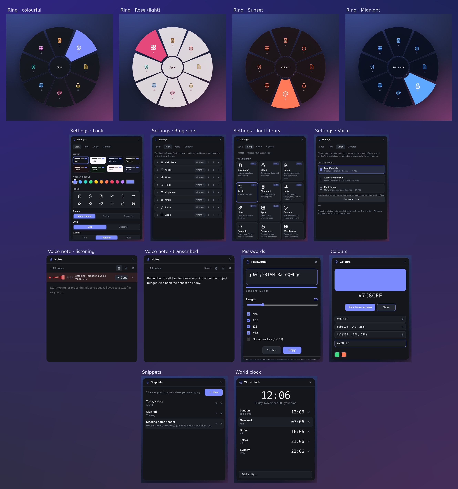

# Wheelie

A radial "weapon wheel" menu for Windows, built for personal use. Hold a shortcut, a ring of tools opens around your pointer, point at one and let go.

Inspired by [Helix](https://tryhelix.app/) (Mac). This is an independent rewrite for Windows: no code, artwork or branding is shared.

## Using it

| Do this | To get |
| --- | --- |
| Hold **Alt + Space** (or the **middle mouse button**) | The ring opens at your pointer |
| Move to a slice and release | Opens that tool |
| Release in the centre hub | Cancels |
| Quick tap instead of a hold | Ring stays open: click a slice, or press **1-8** |
| **Esc**, or click away from a panel | Closes it |
| Click the tray icon (or right-click for the menu) | Opens the Wheelie app: Open Wheelie / Quit |

### Two parts: the wheel, and the app

- **The wheel** is the quick-touch overlay: hold, point, let go. It stays out of the way and starts instantly.
- **The Wheelie app** is a normal window where everything is customised: themes and colours, which tool sits in each slot (with a live ring you can click), the tool library, voice, and startup. It starts quietly in the tray when Windows starts, so the wheel is always ready. Click the tray icon to open it. Closing its window just hides it; **Quit** is in the tray menu and in the app's General page.
- Changes made in the app reach the wheel immediately, no restart.

The first time Wheelie runs it opens the app and sets itself to start with Windows. You can switch that off in *Home* or *General*.

### The ring, slots and the tool library

The ring has **8 slots**. Each slot holds either a **tool from the library** or a **launcher** that runs an app, folder or link the moment you release over it (no panel). Open the app's **Ring** page to change what is in each slot, reorder, or empty a slot (at least 2 must stay). Picking a tool that is already in another slot swaps the two.

Library: Calculator · Clock · Notes · To-do · Clipboard · Units · Links · Apps · **Colours** (eyedropper + saved palette) · **Snippets** (saved text, `{date}` `{time}` `{weekday}` filled in, click to paste) · **Passwords** (strong random passwords) · **World clock**

### Look and motion

**Appearance** (in the app): 8 themes (Dark, Light, Midnight, Graphite, Sunset, Forest, Rose, Tinted), 10 accent colours plus a custom picker, icon colour (match theme / accent / colourful), icon style (line / duotone), icon weight, ring transparency, and motion (Full / Subtle / Off; also respects the Windows reduced-motion setting).

The icons are Wheelie's own set, drawn as SVG, and they animate on hover (the stopwatch hand sweeps, the lock opens, the chain links part, calculator keys ripple...).

**Motion** is built on spring physics rather than fixed easing curves, so it behaves like iOS: things move with momentum, overshoot a touch, settle naturally, and can be redirected mid-flight without a jolt.

- **Launch:** the ring blooms out of its centre, slice by slice clockwise, with a soft blur-in.
- **Hover:** the slice under the pointer leans toward it and grows, its neighbours are pulled a little (like the macOS Dock), the whole ring tilts slightly toward the pointer, and a soft highlight follows it.
- **Choosing:** the picked slice pulses and dissolves into the panel, which grows out of that slice on a spring. Closing fades it away.

### Every motion, previewed

Open the **motion gallery** (`npm run dev`, then <http://localhost:1420/gallery.html>) to hover and click every animation live: the wheel, all 29 icons, panels and row cascades, the app shell, switches and bars, the voice bar and the calculator keys, with a switch for theme and for Full / Subtle / Off. It is built from the app's own code.

Or watch them as GIFs (captured frame by frame):

| Motion | Preview |
| --- | --- |
| Wheel launch | [motion-launch.gif](docs/previews/motion-launch.gif) |
| Hover: lean, Dock-style pull, tilt, highlight | [motion-hover.gif](docs/previews/motion-hover.gif) |
| Choosing a tool: the panel grows out of the slice | [motion-choose.gif](docs/previews/motion-choose.gif) |
| Cancelling (release in the hub) | [wheel-cancel.gif](docs/previews/motion/wheel-cancel.gif) |
| Full vs Subtle vs Off | [motion-levels.gif](docs/previews/motion/motion-levels.gif) |
| The app opening | [app-open.gif](docs/previews/motion/app-open.gif) |
| Moving around the app | [app-navigation.gif](docs/previews/motion/app-navigation.gif) |
| Tool icons | [icons-tools.gif](docs/previews/motion/icons-tools.gif) |
| Launcher icons | [icons-launchers.gif](docs/previews/motion/icons-launchers.gif) |
| Panel opening (row cascade) and closing | [panel-open-close.gif](docs/previews/motion/panel-open-close.gif) |
| Switch, progress, card lift | [controls.gif](docs/previews/motion/controls.gif) |
| Voice note bar | [voice-bar.gif](docs/previews/motion/voice-bar.gif) |
| Calculator keys | [calculator-keys.gif](docs/previews/motion/calculator-keys.gif) |

### Voice notes

In **Notes**, press the mic (or the mic next to *New* for a brand-new voice note), speak, then press **Done**. Your words are written into the note and saved as text like anything you type.

- **Private:** speech is turned into text **on your PC** by a small Whisper model. Audio is never uploaded and never saved, only the text.
- **First use:** the model (about 45 MB) downloads once from Hugging Face, then works offline. You can pre-download it, or pick a more accurate or multilingual model, in **the app's Voice page**.
- Windows may ask to allow microphone access the first time. If it was blocked, enable it in *Settings → Privacy & security → Microphone*.

### Tools (v1)

- **Calculator**: its own keypad and design (nothing from Windows is launched). Type on the keyboard or click keys, live result as you type, `fx` for scientific keys, history. `=` copies the result.
- **Notes**: every note is a plain **`.txt` file** in `Documents\Wheelie Notes`, so you can open, back up or sync them with anything. The Notes tool shows a searchable history (newest first, with a preview and date), autosaves as you type, and never creates empty files. Deleting asks for a second click.
- **Clock** (stopwatch, timer, pomodoro) · **To-do** · **Clipboard history** (click to paste) · **Unit converter** · **Links** · **App launcher**



More screens are in [`docs/previews`](docs/previews).

## Get it on Windows

Pushing to GitHub runs `.github/workflows/windows.yml`, which builds on a Windows runner and uploads:

- `wheelie-windows-installer`: the `.exe` installer (per-user, no admin needed)
- `wheelie-windows-portable-exe`: just `wheelie.exe`

Open the workflow run on GitHub, download the artifact, run it. Windows SmartScreen will warn because the app is unsigned: **More info → Run anyway**.

## Develop

Prerequisites on Windows: [Node 22+](https://nodejs.org), [Rust](https://rustup.rs), and the Visual Studio C++ build tools. WebView2 ships with Windows 10/11.

```sh
npm install
npm run tauri dev      # the real app, with the global hooks (the first run also registers start-with-Windows; turn it off in the app)
npm run tauri build    # produces the installer in src-tauri/target/release/bundle/nsis
```

The UI can also be developed in any browser, on any OS, without Rust:

```sh
npm run dev            # the wheel: hold the middle mouse button, or Space, to open the ring
                       # the app: http://localhost:1420/studio.html
npm test               # calculator parser + unit conversion tests
```

(`cargo test --manifest-path src-tauri/Cargo.toml` runs the trigger state-machine and notes-file tests.)

## How it works

```
src-tauri/src/
  trigger.rs    Hold/release logic as a pure state machine (unit tested, no OS calls)
  hook_win.rs   Windows low-level keyboard + mouse hooks that feed trigger.rs
  winutil.rs    Focus handling, paste (Ctrl+V injection), clipboard format checks
  clip.rs       Clipboard history thread (in memory only)
  notes_core.rs Notes as .txt files: list/read/write/delete (unit tested, path-traversal safe)
  notes.rs      Tauri commands wrapping notes_core
  main.rs       Overlay window placement, the app window, tray, launch at login, commands
src/
  main.ts       The overlay: ring/panel state machine, slot activation
  ring.ts       Ring engine: springs, hover lean, Dock-style pull, tilt, launch/choose animations
  ringmath.ts   Ring geometry (hit-testing, pointer influence), unit tested
  layout.ts     Placing a panel on screen, unit tested
  motion.ts     Spring physics: live springs, and springs baked into CSS easings
  studio/       The Wheelie app window: shell, live ring preview, one file per page
  model.ts      Settings + slot model (migration from older settings), unit tested
  themes.ts     Theme palettes and applying appearance
  icons.ts      Wheelie's animated icon set;  iconMotion.css: the motion
  tools/        One file per tool; registry.ts is the library
  voice/        Recorder, Whisper worker, dictation controller
  bridge.ts     Seam to Rust; simulated in a plain browser
```

One transparent, always-on-top window does everything. On a hold, Rust moves it under the cursor, shows it, and streams pointer positions to the UI (the window isn't focused yet, so the UI can't read the mouse itself). Near a screen edge the ring is moved fully on-screen and the cursor is moved to its centre.

## Things to know

- **Global hooks.** Wheelie installs Windows low-level keyboard and mouse hooks. They look only at Space/Alt and the mouse button you chose, and nothing is recorded or sent anywhere. The logic is in `trigger.rs` and `hook_win.rs` if you want to check.
- **The trigger is swallowed.** While Wheelie is running, Alt+Space no longer opens the window menu, and the chosen mouse button no longer works normally in other apps. Change or turn off either in Settings.
- **Clipboard history is memory-only** and skips copies flagged by password managers. It is cleared when you quit.
- **Your data** stays on your machine. Notes are `.txt` files in `Documents\Wheelie Notes`; to-dos, links, settings and calculator history live in the app's local WebView storage. There is no account and no network use.
- **Status:** the Windows-only code compiles cleanly for Windows, and the logic and UI are tested, but the finished app has not yet been run on a real Windows machine. Expect to find a rough edge or two in focus handling.

## Ideas for next

Launch at login · Ask AI tool (your own API key) · Screenshot / colour picker / screen record · window snapping · a second ring of 8 · currency in Units
